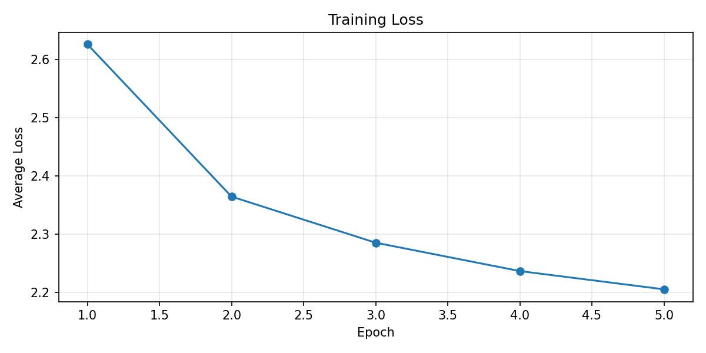
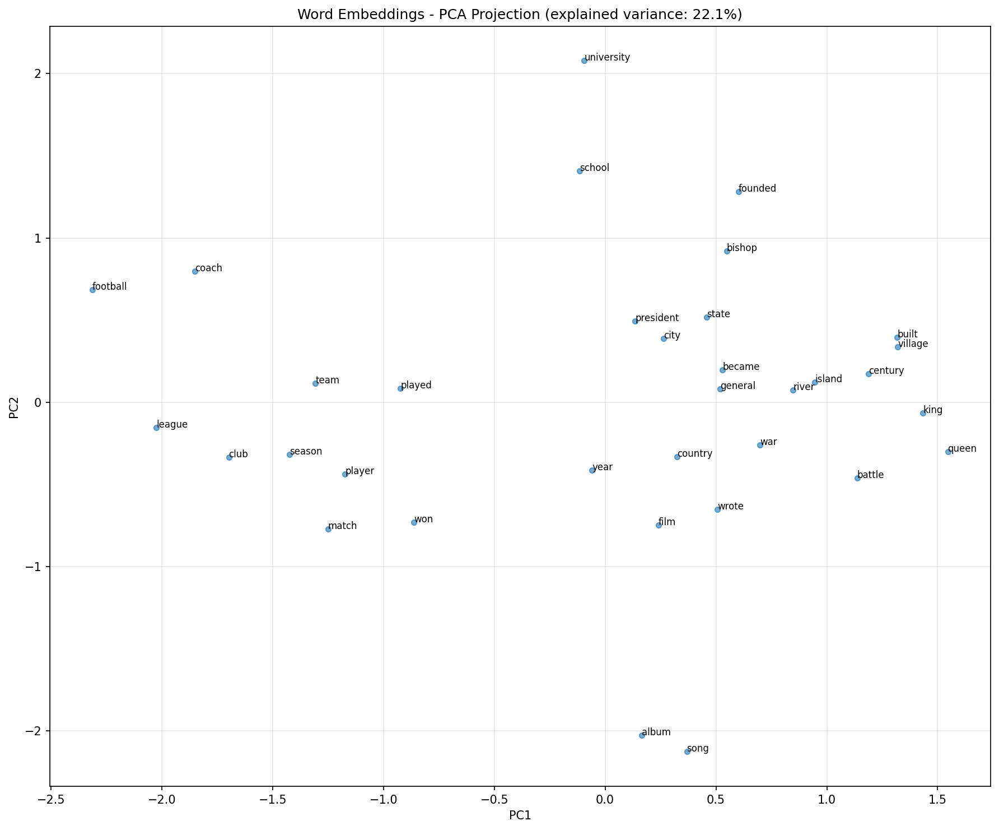

# Word2Vec: Skip-Gram with Negative Sampling in NumPy

A from-scratch implementation of the skip-gram variant of word2vec with negative sampling.

## Model

### Skip-Gram Objective

For a center word $c$ with embedding $v_c$ and a context word $o$ with output embedding $u_o$, the original skip-gram objective models

$$
p(o \mid c) = \frac{\exp(u_o^\top v_c)}{\sum_{w=1}^{|V|} \exp(u_w^\top v_c)}
$$

and minimizes the negative log-likelihood over all observed center-context pairs:

$$
J = - \sum_{(c,o)} \log p(o \mid c)
$$

The expensive part is the denominator: every update depends on all vocabulary items. To avoid that, word2vec replaces the full softmax objective with **negative sampling**, which turns each training pair into a binary classification problem: the observed pair should score high, while randomly sampled noise pairs should score low.

For one positive pair $(c,o)$ and negatives $n_1, \dots, n_K$, the loss is

$$
L(c,o) = -\log \sigma(u_o^\top v_c) - \sum_{k=1}^{K} \log \sigma(-u_{n_k}^\top v_c)
$$

where $\sigma(x) = \frac{1}{1 + e^{-x}}$.

This is the objective implemented in `model.py`.

### Gradients

Let

$$
s_{pos} = u_o^\top v_c, \qquad s_{neg,k} = u_{n_k}^\top v_c
$$

Then the gradients for one training example are:

$$
\frac{\partial L}{\partial v_c}
=
(\sigma(s_{pos}) - 1)u_o
+
\sum_{k=1}^{K} \sigma(s_{neg,k})u_{n_k}
$$

$$
\frac{\partial L}{\partial u_o}
=
(\sigma(s_{pos}) - 1)v_c
$$

$$
\frac{\partial L}{\partial u_{n_k}}
=
\sigma(s_{neg,k})v_c
$$

These are exactly the updates used in `SkipGramNegativeSampling.train_step()`:

- `W_in[center_idx]` stores center-word embeddings $v_c$
- `W_out[context_idx]` stores output/context embeddings $u_o$
- sampled negative output rows receive the negative updates

### Training Details

Hyperparameters: embedding dim 100, window size 5, 5 negative samples, 5 epochs, initial LR 0.025 with linear per-step decay and a small floor. These follow the standard word2vec default. The embedding dimension is kept at 100.

Subsampling: frequent words are downsampled using the Mikolov keep-probability formula. The threshold is set to `1e-4` rather than the original default of `1e-5`, which gave better evaluation results on WikiText-2. This reduces training pairs by removing uninformative high-frequency words like "the" and "of".

Negative sampling: unigram distribution raised to the 3/4 power, drawn from a prebuilt table of 10M entries following the original C implementation. The table avoids repeated np.random.choice calls during training.

Initialization:`W_in` uniform in $\left[-\frac{0.5}{d}, \frac{0.5}{d}\right]$, `W_out` zeros. Zero-initializing the output matrix is standard for SGNS - it ensures the model starts with zero loss gradients from the negative samples.


These choices are intentionally close to the standard word2vec implementation.
## Dataset

I trained the model on **WikiText-2**, a standard small-scale NLP benchmark that is easy to inspect and fast enough for a pure NumPy implementation. The WikiText-2 dataset can be found on [Kaggle](https://www.kaggle.com/datasets/vivekmettu/wikitext2-data?select=train.txt). In this project, the `train.txt` split was used for training.

The preprocessing pipeline in `preprocessing.py` does the following:

- lowercases text
- removes WikiText section-heading lines
- fixes WikiText tokenization artifacts such as `@-@` and `@,@`
- removes `<unk>`
- tokenizes with a simple regex that keeps alphabetic tokens and contractions
- filters the vocabulary with `min_count=5`

The WordSim-353 evaluation dataset used for similarity benchmarking can be found on [Kaggle](https://www.kaggle.com/datasets/julianschelb/wordsim353-crowd).


## Project Structure

```text
.
├── src/                           # training pipeline
│   ├── model.py                   # SGNS model: embeddings, loss, gradients, updates
│   ├── trainer.py                 # training loop: windows, negatives, LR decay
│   ├── preprocessing.py           # corpus loading, tokenization, vocabulary building
│   ├── negative_sampling.py       # unigram^0.75 sampler with prebuilt table
│   ├── subsampling.py             # frequent-word subsampling probabilities
│   └── train.py                   # entry point: training and artifact saving
├── notebooks/
│   └── evaluation.ipynb           # WordSim-353, PCA, nearest neighbors, analogies
├── data/
│   ├── raw/wikitext-2.txt         # WikiText-2 training corpus
│   └── eval/wordsim353crowd.csv   # WordSim-353 evaluation pairs
├── artifacts/                     # saved outputs from training and evaluation
│   ├── embeddings.npy
│   ├── vocab.json
│   ├── epoch_losses.npy
│   ├── training_loss.png
│   └── pca_projection.png
├── requirements.txt
└── README.md
```

### Training

Run:

```bash
python src/train.py
```

This script:

- preprocesses WikiText-2
- trains SGNS embeddings
- saves artifacts to `artifacts/`

### Evaluation

The evaluation notebook performs:

- WordSim-353 correlation evaluation
- random-embedding baseline comparison
- PCA visualization of selected words
- nearest-neighbor inspection
- analogy probing

## Results

### Training

The average training loss decreases across epochs, which is a basic sanity check that the optimization is working and the gradients are pointing in the right direction.



### WordSim-353

I evaluated the learned embeddings on the WordSim-353 similarity benchmark using cosine similarity and Spearman rank correlation.

| Model | Spearman $\rho$ | p-value |
|---|---:|---:|
| Random baseline | 0.0361 | 0.5336 |
| Trained embeddings | 0.4396 | ~0 |

**Coverage:** 299 / 353 pairs (84.7%)

This is the main quantitative result of the project: the trained embeddings correlate substantially better with human similarity judgments than randomly initialized vectors, which indicates that training learned real semantic structure rather than noise.

### PCA

A 2D projection of selected words onto the first two principal components.



In this 2D projection, many
relatively similar words appear close to each other, which suggests that the
embeddings contain some semantic information. At the same time, the first two
principal components explain only about 22% of the variance in the selected word
vectors, so this plot shows only a limited view of the full embedding space.

### Nearest Neighbors

For domain-specific nouns, the embeddings capture clear semantic structure: `france` retrieves other European countries (Italy, Netherlands, Sweden, Austria), `england` retrieves Scotland and Wales, and `queen` retrieves royalty-related terms (elizabeth, duchess, anne). The `king` neighbors (murchad, ragnaill, donnchad) are obscure medieval rulers from Wikipedia - rare words that appear almost exclusively near "king," so their embeddings collapse onto it.

Common polysemous words like `man` and `woman` produce noisy neighbors. These words appear in too many diverse contexts for a single vector to represent well.

### Analogies

Analogy retrieval does not produce the intended answers. `paris:france::london:?` returns countries (Sweden, Denmark, Netherlands) rather than "england" - the model captures a capital-to-country direction but it is too noisy for exact retrieval. `man:king::woman:?` returns unrelated terms, reflecting the poor embeddings for polysemous words like `man` and `woman` discussed above.

This is expected: analogy evaluation is demanding, and the original word2vec results relied on corpora roughly 1000× larger than WikiText-2.


## Limitations

Training is single-threaded and processes one center-context pair at a time. The original word2vec uses multi-threaded  updates. On WikiText-2 this is manageable, but it would not scale to larger corpora without either parallelism or batching.

The context window is fixed at size 5. The original word2vec samples the actual window size uniformly from `[1, window_size]` at each step, effectively downweighting distant context words. A fixed window overweights distant pairs relative to the original.

The model was trained on WikiText-2 (~2M tokens), which is roughly 1000× smaller than the Google News corpus used in the original word2vec experiments. Many evaluation weaknesses - particularly analogy failure - are primarily a consequence of corpus size rather than implementation issues.

## References

1. Tomas Mikolov, Kai Chen, Greg Corrado, and Jeffrey Dean. *Efficient Estimation of Word Representations in Vector Space*. ICLR Workshop, 2013. [arXiv](https://arxiv.org/abs/1301.3781).
2. Tomas Mikolov, Ilya Sutskever, Kai Chen, Greg S. Corrado, and Jeffrey Dean. *Distributed Representations of Words and Phrases and their Compositionality*. NeurIPS 2013. [arXiv](https://arxiv.org/abs/1310.4546).
3. Original word2vec C implementation by Tomas Mikolov et al. [GitHub](https://github.com/tmikolov/word2vec).